# cursive-writing

Text in, joined single-line cursive out, as SVG for a pen plotter.

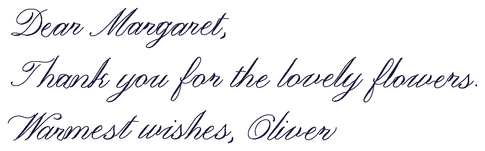

Ordinary script fonts don't work on a plotter for two reasons:

- They are outline fonts, so the plotter traces both edges of every stroke.
- Their letters only overlap rather than truly join.

This project rebuilds each letter as a single pen path, then joins letters inside a word with real connecting strokes. Every word is drawn as one continuous line, like handwriting.

Seven styles are included:

| style | look | built from (SIL OFL) |
|---|---|---|
| `copperplate` | formal, steep slant, looped ascenders | Pinyon Script |
| `spencerian` | light, airy, flourished capitals | Monsieur La Doulaise |
| `modern` | rounder and cleaner | Parisienne |
| `formal` | copperplate-like, with word-final and word-initial letter forms | Great Vibes |
| `signature` | brisk brush script, no ascender loops | Alex Brush |
| `flowing` | light, looped ascenders, long descender loops | Allura |
| `roundhand` | upright and round, even line, italic-like | Petit Formal Script |

The same card in each style (x-height 5 mm, seed 3, no shading):

**copperplate**

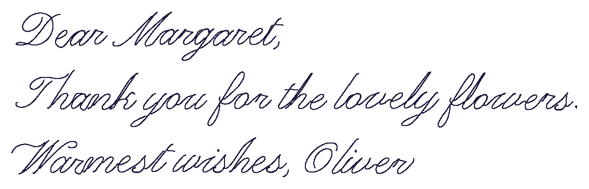

**spencerian**

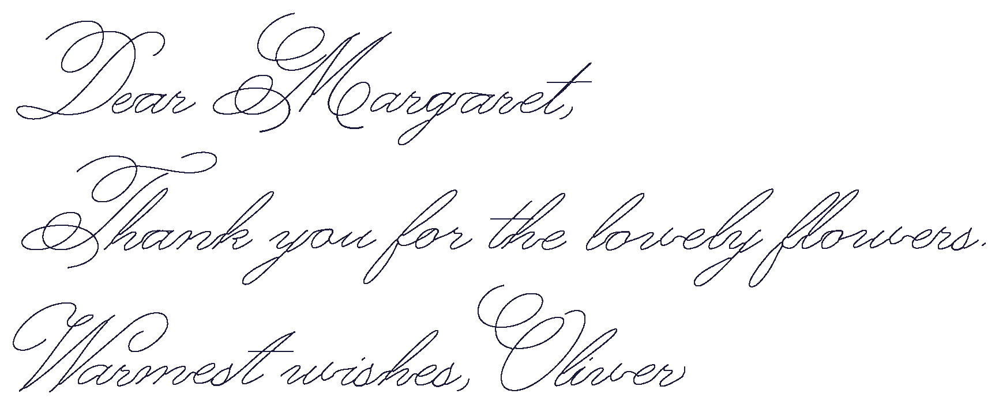

**modern**

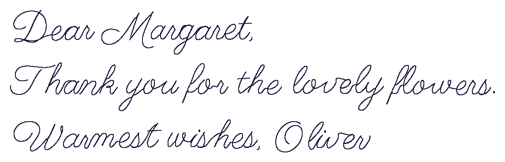

**formal**

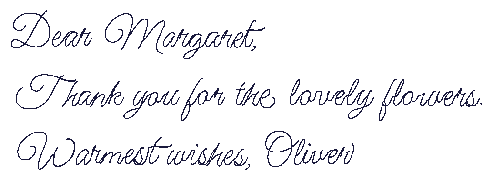

**signature**

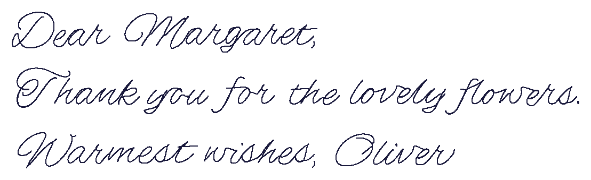

**flowing**

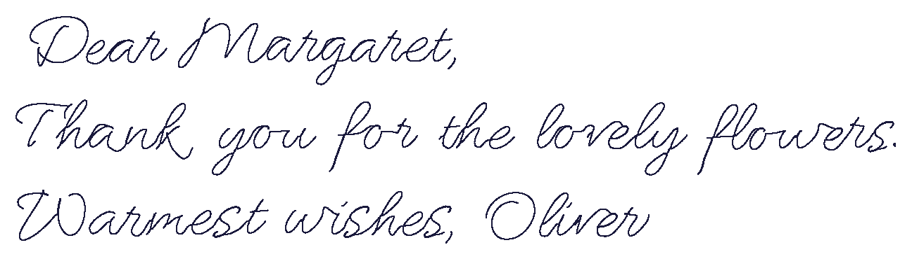

**roundhand**

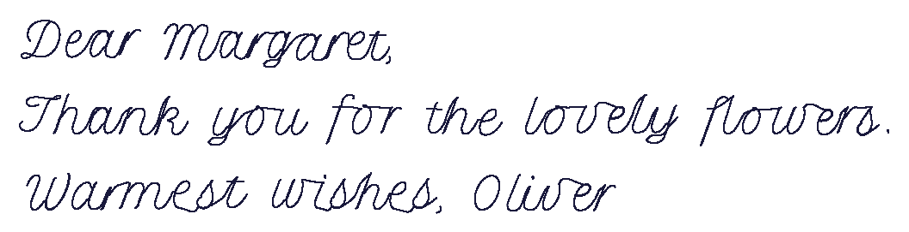

## Usage

```sh
python3 -m venv .venv && .venv/bin/pip install numpy pillow
# extra libraries needed only to (re)extract glyphs from fonts:
.venv/bin/pip install freetype-py fonttools scikit-image scipy skan pytest

.venv/bin/python -m cursive.cli "Dear friend,\nThank you for everything." \
    --style copperplate --size 6 --page a5-landscape --margin 15 \
    --seed 3 --shade 0.6 -o card.svg --png card.png
```

| option | meaning |
|---|---|
| `--size` | x-height in mm. Capitals and ascenders are roughly 2.5–3× this. The CLI warns when the size is too small for `--pen` (see *Legibility* below). |
| `--page` | `a4`, `a5`, `a6`, `letter`, `dl`, `c5`, add `-landscape`, or `WxH` in mm. |
| `--seed` | Picks the random variation. The same seed always gives the same output. |
| `--variation` | `0` gives identical letters every time; `1` is the default; higher is looser. |
| `--shade` | Imitates pointed-pen thick downstrokes by adding extra pen passes, up to this width in mm. The passes are woven into the stroke, so they add no pen lifts. |
| `--align` | `left` / `center` / `right` |
| `--list-chars` | Print every character the style can write and exit (`--style all` lists every style). Any other character in the text is left out, with a warning naming it; the web page shows the same warning and lists the characters under *Style*. |

### What the options do

**`--variation`** — `0`, `1` (default), `2`. With `0` every copy of a letter is identical; higher values loosen size, slant, spacing and baseline.

| `--variation 0` | 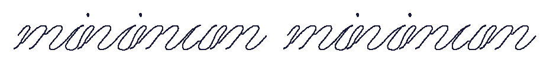 |
|---|---|
| `--variation 1` | 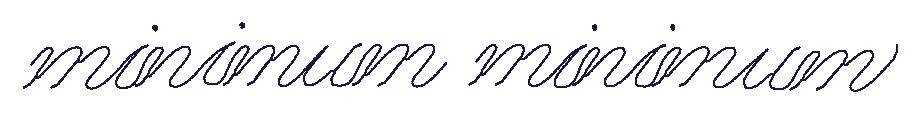 |
| `--variation 2` | 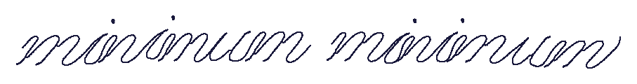 |

**`--seed`** — the same text and settings with three seeds. Each seed gives different letter shapes, and repeats exactly.

| `--seed 1` | 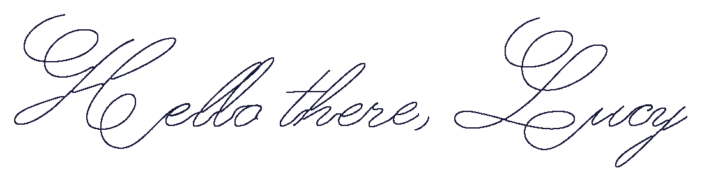 |
|---|---|
| `--seed 2` | 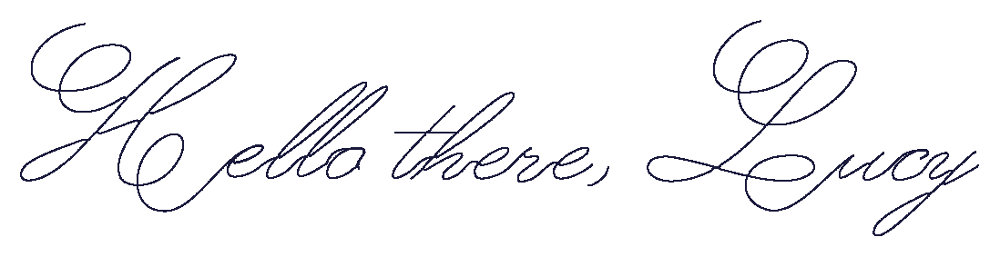 |
| `--seed 3` | 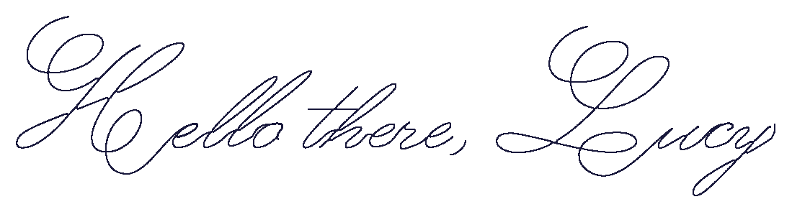 |

**`--shade`** — off, and `0.6` mm. Downstrokes get thicker, like a pointed pen; the plotter still draws each word in one stroke.

| `--shade 0` | 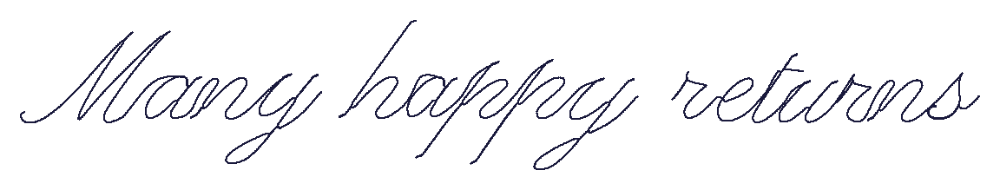 |
|---|---|
| `--shade 0.6` | 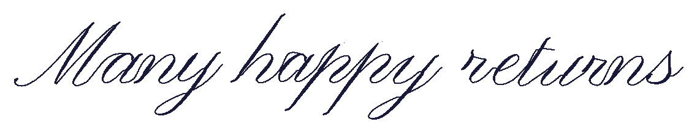 |

**`--size`** — the x-height in mm, shown here at the same scale: 4 mm and 8 mm. The pen width stays the same, so small writing looks heavier (see *Legibility*).

| `--size 4` | 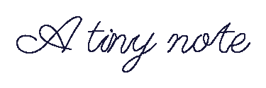 |
|---|---|
| `--size 8` | 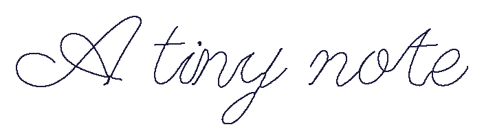 |

The samples are made by `python tools/readme_images.py`; re-run it after changing glyphs or joins.

### Output

The SVG is in millimetres. All ink sits in one Inkscape layer, with a group per line, so it plots directly from Inkscape or a plotter's own SVG tools.

Pen-up travel is already short. Each word is one stroke, followed by its i-dots and t-bars in left-to-right order, and words run in reading order. Shading never adds lifts.

## In the browser

**Try it:** <https://unigamer.github.io/cursive-writing/> · **Single file:** [cursive-writer.html](https://github.com/unigamer/cursive-writing/releases/latest/download/cursive-writer.html) (download, then open it; works offline)

Publishing a GitHub release runs `.github/workflows/release.yml`. It runs the tests, builds the single-file page, attaches it to the release, links it from the release notes, and updates the GitHub Pages site. To refresh the site without a release, run the workflow by hand from the Actions tab.

`web/` is a static page that does the same job with no backend. All the layout and joining runs in the browser, in a JavaScript port of the engine.

```sh
python3 tools/build_web.py           # bundle styles/ into web/data/ (after any glyph, pair or style edit)
python3 -m http.server -d web 8000   # then open http://localhost:8000
```

Any static host can serve the `web/` folder (GitHub Pages, Netlify, S3…). Opening `index.html` straight from disk won't work, because browsers block module scripts and `fetch` on `file://` pages.

To share it as **one HTML file** that needs no server, build the standalone page. It holds the CSS, the engine and the style data (about 2.2 MB with all seven styles), works offline and opens straight from disk:

```sh
python3 tools/build_web.py --standalone                          # dist/cursive-writer.html
python3 tools/build_web.py --standalone card.html copperplate    # only some styles, smaller file
```

The engine modules are joined into one script by a small bundler in `build_web.py` (no npm needed), and `web/standalone.js` runs it in a Worker made from a blob. If the browser refuses that worker, it runs the engine on the page instead.

- It has the same options as the CLI, with a live preview. Generation runs in a Web Worker, so typing stays responsive.
- **Download SVG** saves exactly the file the CLI would write for the same settings, byte for byte. **PNG** saves a 150 dpi preview.
- **Copy CLI** copies the equivalent `python -m cursive.cli …` command.
- Settings are kept in the URL, so a link reproduces the same writing.

How it stays identical to Python:

- `web/cursive/*.js` mirrors `glyph`, `join`, `variation`, `layout`, `spacing` (even spacing), `shade` and `render` function by function. Where rounding matters it follows numpy's evaluation order, for example pairwise summation and `np.interp`.
- `web/cursive/rng.js` reimplements `numpy.random.default_rng` (SeedSequence, PCG64, the ziggurat normal sampler, `uniform` and `integers`) draw for draw. The same seed therefore gives the same letters.
- `web/data/<style>.json` holds the style's `style.json`, `pairs.json` and glyph files, gathered into one file per style because a browser can't list a directory. The numbers are unchanged; fields the engine never reads (glyph `source`, pair `score`…) are dropped.

`tests/test_web.py` runs the JS under deno or node (it is skipped if neither is installed) and checks:

- the bundles are up to date
- the random stream matches numpy exactly
- every letter pair in every style joins identically, with and without variation
- whole pages give byte-identical SVG
- the standalone page has no outside references, and its bundled engine writes the same SVGs

**When you change the engine in `cursive/`, make the same change in `web/cursive/`.** These tests will catch any drift.

## Joining rules

- Letters join only **within a word**. A space, line break, punctuation, digit or symbol always lifts the pen.
- Capitals join only where the style says that's traditional: `"join_capitals"` in `style.json` (Spencerian: H I J L Q U V). Other capitals stand alone, kerned a little tighter than ordinary letters (see *Even spacing*).
- Each glyph declares whether it can be joined into (`entry`) and whether it joins onward (`exit`). `"none"` means never.
- `style.json` can block more joins:
  - `no_join_after`: characters that never join to the next letter (punctuation and digits by default)
  - `no_join_before`: characters that never accept a join from the previous letter
  - `no_join_pairs`: individual pairs such as `"Bo"`
- Everywhere else, letters join.

## How it works

1. **Extraction** (`tools/extract_glyphs.py`, `cursive/extract.py`)
   1. Render each font glyph.
   2. Skeletonize it to a 1-pixel centreline.
   3. Build a graph of the skeleton, then merge junction clusters and prune spurs.
   4. Search exhaustively for the most natural pen order. The search:
      - prefers going straight through junctions
      - keeps retracing low
      - avoids climbing thick strokes. Pointed-pen scripts are shaded on downstrokes, so a thick stroke shows which way the pen moved.
      - starts left and ends right on the slant-corrected axis
      - avoids starting or ending on ascender or descender tips
      
      Ornate capitals with very large skeleton graphs fall back to a greedy walk that still covers every line.
   5. Crossbars (t) are split off and drawn after the word, with the `bar` hint.
   6. Dots become small spirals.
   7. Each glyph gets automatic **lead-in** and **lead-out** cut points: the entry upstroke and the exit hairline. An entry stroke that belongs to a loop (the eye of an e) is only cut up to the crossing.
   8. Capitals that finish high or to the side (B, D, O, P, S…) are marked as non-joining, as is any letter that ends on a descender tip.
2. **Joining** (`cursive/join.py`)

   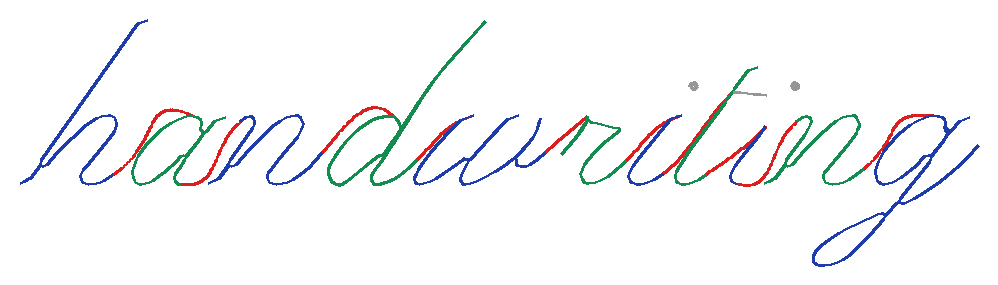

   *Letters alternate blue and green; the red connectors are made by the join engine. Grey is drawn after the word (i-dots, t-bar).*

   - When two letters join, the first letter's lead-out and the second's lead-in are cut off and replaced with one connector curve.
   - The connector leaves smoothly along the first letter's direction of travel.
   - Into oval letters (a, o, d, g, q) it sweeps under the oval and rises along the slant, so it meets the oval in a sharp point.
   - Into a downward-drawn ascender (l, h, b, k) it climbs, curls over the top and forms the loop.
   - Letters that open with a closed loop (o, a, d, g, q) can be entered three ways, redrawing the same ink from a different start:
     - over the top (after b, o, v, w)
     - at the top-right corner
     - with a smooth under-curve into the bottom of the oval
   - A "retrace" arrival runs the hairline up a letter's first stem and turns sharply back down it, giving the pointed tops of i, u and t.
   - `tools/pairs.py optimise` chooses the best of these for every pair (see below).
   - Into letters that open with a small hook (c, and some a, d, q), the connector reaches the top. The pen flicks out along the hook and back before drawing the letter's back, which keeps c distinct from e.
3. **Variation** (`cursive/variation.py`)
   - Seeded per-letter jitter: size, width, slant, baseline, spacing.
   - Ascender and descender loops vary in width and length from letter to letter (`loop_width`, `loop_height`), so repeated letters don't look stamped. The x-height body is untouched, so joins still meet.
   - Some word-final letters get a slightly longer finishing hairline that curls upward (`flourish`, the chance per word).
   - Plus a smooth displacement field applied to whole lines after joining. It wobbles the line without ever breaking a join.
4. **Layout** (`cursive/layout.py`)
   - Word gaps are measured on the ink in the x-height band, with the slant removed, so descender loops and t-bars don't distort spacing.
   - Then the actual ink is checked, flourishes and hairlines included. If any part of a word comes closer to the previous word than the style's `word_clear` (default 0.9 × the letter gap), the word moves right, by at most 1.2 x-heights so spacing stays even. Closer than a letter gap, two words read as one: flowing's exit hairlines and capital lead-ins used to do this ("PaulKevin").
   - Words never touch. A big swash that is still within 0.3 x-heights after that (Spencerian W or J reaching back over the previous word) is pushed further, up to 4 x-heights.
   - Line breaks count these pushes, so a line never runs past the page width.
   - Every space counts: two spaces leave twice the word gap, and spaces at the start of a paragraph indent its first line. Trailing spaces, and spaces where a line wraps, take no room. A tab counts as one space.
   - Lines wrap to the page width.
5. **Even spacing** (`cursive/spacing.py`, `"even_spacing"` in `style.json`)
   - Lowercase letters are re-spaced so the gap between letter bodies is the same for every pair. Bodies are measured without their entry and exit hairlines, since the joins replace those.
   - Round letters tuck in slightly, as they do optically.
   - A capital that doesn't join is kerned tighter, to `capital_gap` (default 0.72 × the letter gap). There's no connector bridging the gap after it, so a full letter gap there reads as too wide.

Glyphs are plain JSON in `styles/<style>/glyphs/`, in x-height units (baseline y=0, x-height y=1). Variants sit beside the main file:

| file | used |
|---|---|
| `a.alt1.json`, `a.alt2.json` | picked at random |
| `e.init.json` | as the first letter of a word |
| `e.fina.json` | as the last letter of a word (trailing punctuation ignored) |

Extract a font's own alternates by glyph name with `--variants`, e.g. `--variants "e.fina t.fina b.init g.alt"`. Only Great Vibes (formal) ships useful ones; the other fonts have none, which is why loop variation and flourishes are procedural.

Every style has the same 156 characters (`--list-chars` lists them):

- a–z, A–Z and digits
- the Western European letters: `à á â ã ä å æ ç è é ê ë ì í î ï ñ ò ó ô õ ö ø ù ú û ü ý ÿ œ ß`, and their capitals
- punctuation and symbols: `. , ; : ! ? ¡ ¿ ' " ‘ ’ “ ” « » - – — … & ( ) / % £ € $ @ # + = *`

**Accented letters are composed, not traced.** `é` is the style's own `e` (with its hand edits, alternates and positional forms) plus an acute accent drawn after the word, like an i-dot. It carries `"base": "e"`, so it joins, kerns and uses the pair table exactly like `e`, and `café` is written with the same pen path as `cafe`. The accents come from the source font: `tools/compose_glyphs.py` renders each accented glyph, subtracts the plain letter and traces what is left into `styles/<style>/marks.json`. Marks too small to trace become a straight dash, or a circle for a ring. The slash of ø and Ø is drawn straight through the bowl. The accented i's are built on a dotless i.

```sh
python tools/compose_glyphs.py copperplate --sheet accents.png   # (re)write every composed letter
python tools/compose_glyphs.py copperplate --remark "éÉ"          # re-trace these marks from the font
```

Composed files are rewritten on every run, so re-run it after editing a base letter; `tests/test_compose.py` fails while any is stale. To move an accent, edit its points in `marks.json` and re-run. æ, œ, ß, Æ and Œ are traced like any other letter and have their own optimised pairs.

## Tuning a style

### Glyph editor

```sh
.venv/bin/python tools/editor.py        # then open http://localhost:8765
```

A local web page for fixing glyphs by hand, with a live preview of the edited letter joined into real words (red = connectors):

- drag points, with an adjustable brush that moves neighbouring points too
- add points (double-click) and delete them (Alt-click)
- drag the lead-in and lead-out cut markers, and the advance handle
- set entry and exit types
- reverse, split, join, smooth or resample strokes
- toggle a stroke as drawn after the word (e.g. a crossbar)
- edit the style's `no_join_pairs`

Saving marks the glyph `"edited"` and keeps a timestamped backup in `styles/<style>/.backup/`. Re-extraction with `--force` never overwrites edited glyphs unless you also pass `--overwrite-edited`.

### Check sheets and audit

```sh
python tools/sheets.py glyphs  copperplate -o glyphs.png [--chars ABC | --all]  # lead-in/out red, start green
python tools/sheets.py bigrams copperplate -o bigrams.png       # all 26x26 lowercase joins
python tools/sheets.py word    copperplate hello block -o w.png # letters blue/green, connectors red
python tools/audit.py [style ...]                               # flags suspicious pen paths
```

### Optimising every letter pair

```sh
python tools/pairs.py optimise spencerian            # writes styles/spencerian/pairs.json
python tools/pairs.py stats spencerian               # score summary and the worst pairs left
python tools/pairs.py sheet spencerian -o worst.png  # worst joins: default | optimised
python tools/pairs.py sheet spencerian --pairs "Ho oa bo" -o some.png
```

Each style has about 1,650 pairs: every lowercase pair, plus every capital followed by a lowercase letter (a–z and A–Z, plus æ, œ, ß, Æ and Œ; composed letters such as é use their base letter's pairs). Each join is scored automatically (`cursive/pairs.py`), adding penalties for:

- the connector crossing a letter, or running along on top of one
- letters colliding
- loops, kinks and too much turning
- connectors that are too long or too far
- dips below the baseline and overshoots above
- swooping down to the baseline after a letter whose body ends up high (b, o, v, w)
- sliding in low under an oval letter (a, d, g, o, q) instead of rising to its top
- a kinked departure, or a sharp arrival anywhere but the top of a letter
- connectors that run backwards
- extra spacing
- cutting the top off a letter that starts with a downstroke (an h would turn into an n)

For each pair, a search tries alternatives to the defaults and keeps the best:

- exit and entry cut points
- connector tension
- arrival direction
- entering an o over its top
- extra spacing
- entering a closed-loop letter over the top, at its corner, or from below
- a retrace arrival up the stem
- cutting a short entry stroke (the hairline into i, n, u) back to the top of its stem, so a join arriving high goes straight across
- not joining at all, which is cheap after a capital and expensive between lowercase letters

The search starts from several points (the defaults, and each entry form forced on) so it doesn't get stuck. Pairs still scoring poorly then get a joint grid search over exit cut, arrival, entry form and spacing, since some fixes need two settings to change at once. In every style, lowercase pairs average a join score of about 0.1, and every lowercase pair joins. Capitals listed in `join_capitals` join; the rest (K, M, N…) end in a flourish that curls under or back to the left, so joining them would cut through the letter, and standing alone is traditional for them.

The results go in `pairs.json`, which the join engine reads. Re-run `optimise` after editing glyphs. Entries marked `"manual": true` are hand-tuned and are never overwritten.

Pairs that don't join are then kerned so they are spaced like normal letters, with a small clearance for flourishes. The body gap is the style's letter gap, or its tighter `capital_gap` after a capital. Re-run this after changing either in `style.json`:

```bash
python tools/pairs.py kern spencerian
```

### Reviewing what matters most

`tools/review.py` ranks joins by how often the pair occurs in English (counted from `tools/corpus.txt`) times how weak it scores, and draws example words:

```bash
python tools/review.py spencerian -n 40 -o review.png
```

### Legibility

Plotted lines have width, and a letter's counters (the white in an e, o or loop) fill in if the pen is too wide for the size. `tools/legibility.py` measures every counter in the corpus and reports the smallest usable x-height per pen:

```bash
python tools/legibility.py                 # table for all styles
python tools/legibility.py spencerian --letters --size 3 --pen 0.5 -o check.png
python tools/legibility.py --save          # store in style.json; the CLI then warns
```

Minimum x-height (mm) so 95% of counters keep at least half a pen width of white:

| style | 0.3 mm pen | 0.5 mm pen | 0.7 mm pen |
|---|---|---|---|
| spencerian | 1.3 | 2.2 | 3.1 |
| copperplate | 1.6 | 2.6 | 3.6 |
| formal | 2.1 | 3.5 | 4.9 |
| modern | 2.1 | 3.5 | 4.9 |
| signature | 1.8 | 2.9 | 4.1 |
| flowing | 1.2 | 2.1 | 2.9 |
| roundhand | 1.4 | 2.3 | 3.2 |

`--shade` widens downstrokes, so add the shading width to the pen width when using it. Narrow slivers (a t drawn up and back down its stem) and tiny knots where strokes cross are not counted: they close into a thicker line or a dot, which still reads.

### Extraction hints

For fixes that should come from the extractor itself, use `styles/<style>/extract_hints.json`. Hints survive re-extraction:

```json
{ "k": { "start": [1.6, 2.37], "merge": true },
  "o": { "lead_in": 0.0 } }
```

| hint | effect |
|---|---|
| `start` | Forces where the pen starts, in x-height units. |
| `merge` | Joins a letter's separate pieces into one stroke. |
| `bar` | Splits a crossbar off as a separate stroke drawn after the word. |
| `lead_in`, `lead_out`, `entry`, `exit`, `advance` | Override the automatic values. |

## Notes on the letter forms

- Pen order comes from heuristics plus hand edits. `python tools/audit.py` lists glyphs whose path looks unusual (for example a stroke drawn up and back down the same line, which is how pointed tops are made), and the editor is the way to change them.
- Some source fonts don't connect every letter. To make them join, a few letters have exits that the fonts don't have:
  - Allura (`flowing`): b ends in a small loop at the top of its bowl; d and p end on the baseline instead of a downward flick; s runs back along its base.
  - Alex Brush (`signature`) and Petit Formal Script (`roundhand`): g, j, y (and q in roundhand) get a descender loop that comes back up through the stem; p closes its bowl and leaves along the baseline.
  - In every style x is drawn as one stroke through the centre, and its second diagonal is drawn after the word, like a t-bar.
- Spencerian's capitals are tall, so its `line_height` is 8 x-heights. Lowering it lets the flourishes reach into the line above.
- Not built: the optional neural model trained on this engine's output.

## Prior work surveyed

- **sjvasquez/handwriting-synthesis**: Graves's RNN trained on IAM-OnDB; outputs SVG and is used with pen plotters. Casual handwriting, not formal script.
- **Hershey Script / EMS single-line fonts** (Inkscape's Hershey Text extension): true single-stroke fonts, but the joins are crude.
- **templatemaker.nl single-line text**: an adapted single-line Pinyon Script; joins are approximate.
- **Amy Goodchild, "Coding my Handwriting"**: procedural cursive whose entry and exit points depend on the neighbouring letters. The closest in spirit to this project.
- **Google InkSight**: open model that converts images of handwriting into strokes. A possible future way to recover pen order. Not used yet: it needs TensorFlow, and it traces at 224 px, which is coarse. The thickness-aware search covers most cases.
- **DiffInk (ICLR 2026), DSD and others**: research models that generate stroke sequences with style conditioning. They are trained on casual or Chinese handwriting; there is no public dataset of elegant script recorded as pen strokes.

## Licence

- **Code** (Python, JavaScript, the web page, tools): MIT License, see [LICENSE](LICENSE).
- **Style data** (`styles/`, and the copies in `web/data/` and built pages): traced from fonts under the SIL Open Font License 1.1, so it is a modified version of those fonts and stays under the OFL. [styles/LICENSE.md](styles/LICENSE.md) lists each font's copyright and holds the licence. It may be used, changed and redistributed, also commercially and with any software, but not sold on its own, and it must keep those notices. The styles have their own names because "Parisienne", "Petit Formal Script" and "Monsieur La Doulaise" are Reserved Font Names.
- **Fonts** in `fonts/`: SIL Open Font License, see `fonts/OFL-*.txt`.
- **numpy-derived code** in `web/cursive/rng.js` and `geometry.js`: see [THIRD_PARTY_NOTICES.md](THIRD_PARTY_NOTICES.md).
- **Your writing**: SVGs, PNGs and plotted cards made with this are not covered by any of these licences.

When distributing, keep the notices with the data:

- The served web page has `web/LICENSES.txt` (all of the above in one file), linked from its footer.
- The single-file page carries the same text inside it, in a "Licences" section at the bottom and a comment at the top, so sharing just that one HTML file is enough.
- `tools/build_web.py` regenerates `styles/LICENSE.md` and `web/LICENSES.txt` from `fonts/OFL-*.txt`, `LICENSE` and `THIRD_PARTY_NOTICES.md`. A new style needs its font's `OFL-*.txt` in `fonts/`, matching its `source_font`, or the build stops.
